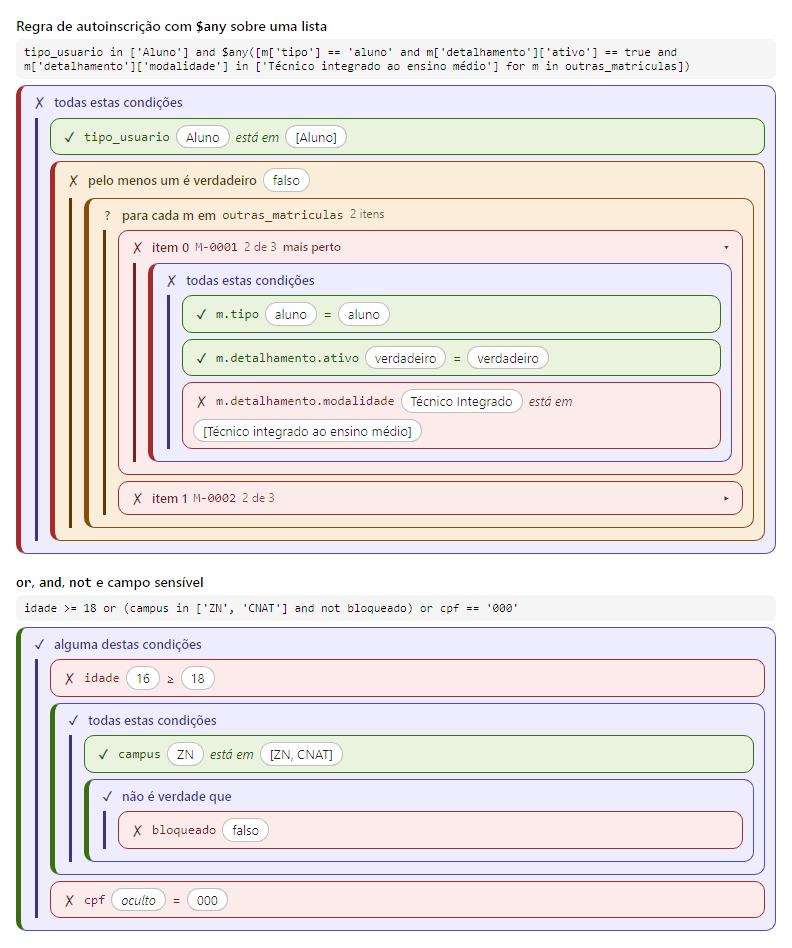

# Django rule-engine - Field, Widget & API

A powerful Django field and widget that brings [rule-engine](https://github.com/zeroSteiner/rule-engine) to your Django projects with a beautiful visual editor, real-time validation, and a clean API.

Perfect for building flexible business rules, access control policies, discount conditions, validation rules, and any scenario where you need dynamic, user-configurable logic.

## ✨ Key Features

### 🎨 Visual Rule Editor
- **Syntax highlighting** for better readability
- **Real-time validation** with immediate feedback
- **Auto-formatting** for JSON example data
- **Keyboard shortcuts** (Ctrl+Enter to validate)
- **Dark mode support** with modern UI

## 🔌 Easy Integration
```python
from django_rule_engine.fields import RuleField

class MyModel(models.Model):
    access_rule = RuleField(
        verbose_name="Access Rule",
        example_data={
            "age": 25,
            "status": "active",
            "role": "admin"
        }
    )
```

## ⚡ REST API
Built-in validation endpoint for frontend validation:
```
POST /api/validate-rule/   # {"rule", "data", "explain": true} also returns "explanation"
POST /api/explain-rule/    # {"rule", "data"} -> {"valid": true, "explanation": {...}}
```

## 🔍 Rule Explanation
Find out *why* a rule matches or not. `explain()` splits the rule on its top-level `and`/`or`,
splits each piece into field / operator / expected value and evaluates everything with
`rule_engine` itself:

```python
from django_rule_engine.explain import explain

explain("age >= 18 and status == 'active'", {"age": 16, "status": "active"})
# {"atendido": False, "operador": "and", "condicoes": [
#    {"condicao": "age >= 18", "atendido": False,
#     "detalhes": {"tipo": "simples", "linhas": [
#        {"campo": "age", "operador": ">=", "esperado": "18", "valor": 16, "atendido": False, ...}]}},
#    {"condicao": "status == 'active'", "atendido": True, ...}]}
```

- `$any([...  for x in LIST])` / `$all(...)` comprehensions (any list, optional `if` filter) are
  detailed per item (`valores`/`resultados` lists);
- `atendido` is `True`/`False`, or `None` when evaluation fails (message in `erro`);
- values of sensitive fields (CPF, e-mail, phone, password...) are hidden by default; change the
  regex with `explain(..., sensitive=r"...")` or the `RULE_ENGINE_EXPLAIN_SENSITIVE_FIELDS` setting
  (`None` shows everything).

The widget uses it when you test the rule with the example data: each piece of the rule is
colored (green = matched, red = not matched, yellow = error) and a "Campo | Esperado | Valor"
table is shown, with one column per item in `$any`/`$all`.


## 🧩 Rule Explanation as Blocks
`explain_tree()` explains **any** rule node by node — mixed `and`/`or`, `not`, nested
comprehensions, ternaries, functions — from the `rule_engine` AST itself, and the result can be
drawn as nested, Scratch-like blocks (green = matched, red = not matched, gray = undefined):



```python
from django_rule_engine.explain_tree import explain_tree

explanation = explain_tree(rule, data)  # {"atendido": False, "raiz": {"tipo": "logico", ...}}
```

```html+django

<link rel="stylesheet" href="">

```

or in the browser: `RuleBlocks.render(element, explanation)` (`rule_widget/rule_blocks.js`).
Both draw the same HTML; sensitive fields stay hidden; colors are CSS variables. The API accepts
`"tree": true` (`/api/explain-rule/`) or `"explain_tree": true` (`/api/validate-rule/`), and the
widget draws the blocks when you test a rule. Full reference (node types, options, theming):
[Explicação em árvore e desenho em blocos](https://django-by-kelsoncm.github.io/django-rule-engine/explicacao-em-blocos.html).

## 🎯 Django Admin Integration
Seamlessly integrates with Django Admin - just add the field and the editor appears automatically!


## 📦 Installation

```bash
pip install django-rule-engine
```

Add to your `INSTALLED_APPS`:
```python
INSTALLED_APPS = [
    # ...
    'django_rule_engine',
]
```

Include URLs:
```python
urlpatterns = [
    path('', include('django_rule_engine.urls')),
]
```

## 💡 Use Cases

- ✅ **Access Control**: Define who can access resources
- ✅ **Business Rules**: Implement complex discount/pricing logic
- ✅ **Validation**: Create dynamic validation rules
- ✅ **Eligibility**: Determine program/service eligibility
- ✅ **Classification**: Classify entities based on criteria
- ✅ **Filtering**: Advanced data filtering and queries

## 🎓 Quick Example

```python
from django.db import models
from django_rule_engine.fields import RuleField

class DiscountCampaign(models.Model):
    name = models.CharField(max_length=200)
    
    rule = RuleField(
        verbose_name="Discount Rule",
        example_data={
            "price": 150.00,
            "quantity": 3,
            "customer_type": "premium",
            "first_purchase": False
        },
        help_text="Example: price > 100 and quantity >= 2"
    )
    
    discount_percentage = models.DecimalField(max_digits=5, decimal_places=2)

    def calculate_discount(self, order_data):
        """Calculate discount based on the rule."""
        if not self.rule:
            return 0
        
        import rule_engine
        rule = rule_engine.Rule(self.rule)
        
        if rule.matches(order_data):
            return float(self.discount_percentage)
        return 0
```

## 📚 Documentation

Comprehensive documentation is included in the package:

- **[INSTALL.md](INSTALL.md)** - Installation and setup guide
- **[QUICKSTART.md](QUICKSTART.md)** - Get started in 5 minutes
- **[EXAMPLES.md](EXAMPLES.md)** - Real-world code examples
- **[MIGRATION_GUIDE.md](MIGRATION_GUIDE.md)** - Migrate existing projects
- **[VISUAL_DEMO.md](VISUAL_DEMO.md)** - Visual demonstration
- **[INDEX.md](INDEX.md)** - Complete documentation index

## 🔧 Requirements

- Python >= 3.10
- Django >= 4.2
- rule-engine >= 4.5.3
- django-json-widget >= 2.0

## 🎯 Tested On

- Python: 3.10, 3.11, 3.12, 3.13, 3.14
- Django: 4.2, 5.0, 5.1, 5.2
- Modern browsers (Chrome, Firefox, Safari, Edge)

### Validation API

REST endpoint for dynamically validating rule-engine rules.

- **Endpoint:** `POST /api/validate-rule/`
- **Explanation:** `POST /api/explain-rule/` (see [Rule Explanation](#-rule-explanation))
- **Documentation:** [fields/README.md](fields/README.md#validation-api)

## 🚀 Quick Start

### 1. Import and Use

```python
from django_rule_engine.fields import RuleField

class MyModel(models.Model):
    rule = RuleField(
        example_data={"age": 25, "status": "active"}
    )
```

## 📚 Documentation

- 

1. **[INDEX.md](INDEX.md)** - Complete documentation index
2. **[INSTALL.md](INSTALL.md)** - Installation guide
3. **[QUICKSTART.md](QUICKSTART.md)** - Quick start (5 min)
4. **[MIGRATION_GUIDE.md](MIGRATION_GUIDE.md)** - Migration guide
5. **[EXAMPLES.md](EXAMPLES.md)** - Code examples
6. **[VISUAL_DEMO.py](VISUAL_DEMO.md)** - Demonstração Visual


## 🎯 Implementation Example

The field is already being used in the `Cohort` model in [coorte/models.py](../../coorte/models.py):

```python
class Cohort(Model):
    name = CharField("cohort name", max_length=256, unique=True)
    rule = RuleField(
        "validation rule",
        blank=True,
        null=True,
        example_data={
            "login": "user123",
            "user": {"email": "user@example.com"},
            "name": "Zé da Silva",
            "active": True
        },
        default="login == 'user123' and user.email != 'user123@example.com'",
    )

    class Meta:
        verbose_name = _("cohort")
        verbose_name_plural = _("cohorts")
        ordering = ["name"]

    def __str__(self):
        return self.name
```
